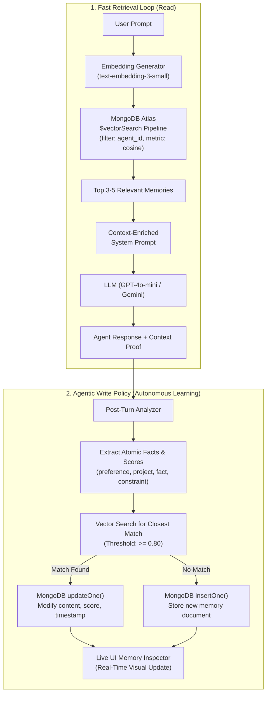

# 🧠 Agentic Memory System (MongoDB Atlas Vector Search)

> A production-ready, full-stack Agentic Long-Term Memory application built for the **MongoDB Atlas Hackathon**. Features continuous memory learning, native Atlas Vector Search (`$vectorSearch`), duplicate resolution via `updateOne`, and a live real-time Memory Inspector dashboard.

---

## 🌟 Overview & Architecture

Autonomous AI agents suffer from amnesia between turns and sessions. The **Agentic Memory System** gives AI agents human-like persistent memory using **MongoDB Atlas** as the cognitive store.

### Dual-Loop Architecture



---

## 📂 Project Structure

```
agentic-memory/
├── src/
│   ├── config/
│   │   └── db.js            # MongoDB Atlas MongoClient, collections, in-memory fallback
│   ├── services/
│   │   ├── embedding.js     # OpenAI text-embedding-3-small + deterministic fallback
│   │   ├── llm.js           # Conversational agent & Agentic Fact Extraction engine
│   │   └── memory.js        # $vectorSearch pipeline, Agentic Write Policy (updateOne vs insertOne)
│   ├── routes/
│   │   └── api.js           # Express endpoints (/api/chat, /api/memories, etc.)
│   ├── scripts/
│   │   └── seed.js          # CLI demo seeding and retrieval verification
│   └── server.js            # Express server initialization & static UI host
├── public/
│   ├── index.html           # Modern split-screen layout with Tailwind CSS & Lucide icons
│   ├── css/
│   │   └── styles.css       # Custom scrollbars, glassmorphism, category badges, animations
│   └── js/
│       └── app.js           # Frontend client: live chat, live memory inspector, real-time log
├── test/
│   ├── unit-test.js         # Automated test suite (all 7 service & vector tests)
│   └── api-test.js          # HTTP integration test suite
├── .env.example             # Template environment variables
├── package.json             # NPM package specification & scripts
└── README.md                # Comprehensive documentation & Atlas setup guide
```

---

## 🗄️ Database & Schema Design (MongoDB Atlas)

The system connects to **MongoDB Atlas** and manages two collections within the `agentic_memory_db` database:

### 1. `agents` Collection
Stores metadata about chat sessions and agent identities:
```json
{
  "_id": ObjectId("65f12a3b4c9e8d7a1f2b3c4d"),
  "agent_id": "default-agent",
  "owner": "hackathon-judge",
  "createdAt": ISODate("2026-10-30T16:00:00.000Z")
}
```

### 2. `memories` Collection
Stores individual extracted atomic facts, their 1536-dimensional embeddings, and relevance metadata:
```json
{
  "_id": ObjectId("65f12a3b4c9e8d7a1f2b3c4e"),
  "agent_id": "default-agent",
  "content": "User prefers Node.js and Express for backend development",
  "category": "preference",
  "embedding": [0.0241, -0.0152, 0.0831, "... 1536 float values ..."],
  "importance_score": 0.90,
  "updated_at": ISODate("2026-10-30T16:15:30.000Z")
}
```

---

## ⚡ MongoDB Atlas Vector Search Index Configuration

To enable lightning-fast semantic retrieval with `$vectorSearch`, create an **Atlas Vector Search Index** named `vector_index` on the `memories` collection.

### Index Definition (JSON)

```json
{
  "fields": [
    {
      "type": "vector",
      "path": "embedding",
      "numDimensions": 1536,
      "similarity": "cosine"
    },
    {
      "type": "filter",
      "path": "agent_id"
    }
  ]
}
```

### Step-by-Step Setup in MongoDB Atlas UI:

1. Log in to your [MongoDB Atlas Dashboard](https://cloud.mongodb.com/).
2. Navigate to your cluster and click **"Atlas Search"** (or **"Search & Vector Search"**).
3. Click **"Create Search Index"**.
4. Select **"Atlas Vector Search"** -> choose the **"JSON Editor"** option.
5. Select your target database (`agentic_memory_db`) and collection (`memories`).
6. Enter **Index Name**: `vector_index` *(exact match required)*.
7. Paste the JSON definition above into the editor.
8. Click **"Next"** and then **"Create Vector Search Index"**.
9. The index status will show as *Initial Sync* and then become *Active* in 1–2 minutes.

---

## 🔍 The `$vectorSearch` Aggregation Pipeline

In `src/services/memory.js`, vector retrieval uses MongoDB's native aggregation pipeline with the pre-filter on `agent_id`:

```javascript
const pipeline = [
  {
    $vectorSearch: {
      index: "vector_index",
      path: "embedding",
      queryVector: queryEmbedding,     // 1536-dimensional float array
      numCandidates: 20,                // Efficient approximate nearest neighbors (HNSW)
      limit: 4,                         // Top 3-5 most relevant memories
      filter: {
        agent_id: { $eq: agentId }      // Scopes search strictly to this agent/user
      }
    }
  },
  {
    $project: {
      _id: 1,
      agent_id: 1,
      content: 1,
      category: 1,
      importance_score: 1,
      updated_at: 1,
      score: { $meta: "vectorSearchScore" } // Cosine similarity score
    }
  }
];

const relevantMemories = await db.collection("memories").aggregate(pipeline).toArray();
```

---

## 🧠 The Agentic Write Policy (Deduplication & `updateOne`)

Rather than blindly inserting redundant facts on every turn, the system implements an **Agentic Write Policy**:
1. **Fact Extraction**: Post-response, the LLM analyzes the turn and extracts atomic assertions (e.g. `User prefers dark mode UI`).
2. **Vector Similarity Check**: The candidate fact is embedded and queried against the agent's memories.
3. **Threshold Decision**:
   - If a memory with similarity **$\ge 0.80$** exists: It is recognized as an update or duplicate. The system modifies the existing document in place using **MongoDB's `updateOne`**:
     ```javascript
     await collection.updateOne(
       { _id: new ObjectId(topMatch._id) },
       {
         $set: {
           content: newFact.content,
           category: newFact.category,
           importance_score: newFact.importance_score,
           embedding: newEmbedding,
           updated_at: new Date()
         }
       }
     );
     ```
   - Otherwise: A fresh document is created via `insertOne`.
4. **Live UI Signal**: The UI highlights the modified card in real time (`memory-updated-flash`).

---

## 🚀 Quick Start & Installation

### 1. Clone & Install Dependencies
```bash
cd "agentic memory"
npm install
```

### 2. Configure Environment Variables
Copy `.env.example` to `.env`:
```bash
cp .env.example .env
```
Edit `.env` with your MongoDB Atlas URI and OpenAI API Key:
```env
MONGODB_URI=mongodb+srv://<username>:<password>@cluster0.xxxxx.mongodb.net/?retryWrites=true&w=majority
DB_NAME=agentic_memory_db
OPENAI_API_KEY=sk-proj-xxxxxxxxxxxxxxxxxxxx
PORT=3000
```

> **Zero-Config Fallback Mode**: If `MONGODB_URI` or `OPENAI_API_KEY` are not set, the application automatically runs in an intelligent fallback mode using local deterministic vector embeddings and in-memory storage. You can test and evaluate the entire UI and vector logic with zero setup friction!

### 3. Run the Automated Test Suite
```bash
npm test
```
Runs 7 unit tests verifying embedding generation, cosine similarity, `$vectorSearch` pipeline ranking, LLM context injection, new fact insertion, and `updateOne` deduplication.

### 4. Seed Demo Data (CLI or Web UI)
```bash
npm run seed
```

### 5. Launch the Web Application
```bash
npm run dev
# or: npm start
```
Open **[http://localhost:3000](http://localhost:3000)** in your browser!

---

## 🖥️ Live Split-Screen Web Interface

The web interface is optimized for hackathon judging and live demonstrations:

- **Left Panel (Chat Window)**:
  - Clean conversational interface with user and agent chat bubbles.
  - **Context-Injected Accordion**: Under every agent response, an expandable card shows the exact memories retrieved from MongoDB Atlas and their similarity scores.
  - **Preset Quick Chips**: One-click prompt suggestions to test memory recall immediately.
- **Right Panel (Live MongoDB Memory Inspector)**:
  - Real-time dashboard showing every active atomic memory in MongoDB Atlas.
  - Automatically updates immediately after every chat turn.
  - Category badges (`preference`, `project`, `fact`, `constraint`).
  - Importance score meters & 1536-dim vector tags.
  - Delete memory button with live optimistic deletion.
  - **Atlas Pipeline Event Terminal**: Collapsible live console logging raw `$vectorSearch` execution times and `updateOne`/`insertOne` operations.

---

## 📡 REST API Reference

| Method | Endpoint | Description |
|---|---|---|
| `POST` | `/api/chat` | Primary chat endpoint: runs `$vectorSearch`, injects memories, returns LLM reply, and executes the Agentic Write Policy. |
| `GET` | `/api/memories/:agent_id` | Returns all stored memories for an agent sorted by `updated_at: -1`. |
| `DELETE` | `/api/memories/:id` | Deletes a specific memory document by its MongoDB `_id`. |
| `POST` | `/api/memories/seed` | Seeds realistic sample memories for instant demo inspection. |
| `DELETE` | `/api/memories/all/:agent_id` | Clears all memories for an agent session. |
| `GET` | `/api/status` | Returns MongoDB Atlas connection status and vector search index health. |

### Sample `POST /api/chat` Payload:
```json
{
  "agent_id": "default-agent",
  "message": "I prefer Express and Node.js for my backend"
}
```

### Sample Response:
```json
{
  "success": true,
  "agent_id": "default-agent",
  "reply": "Got it! I have committed this preference to my persistent memory storage...",
  "retrieved_memories": [
    {
      "_id": "65f12a3b...",
      "content": "User prefers Node.js and Express for backend development",
      "category": "preference",
      "score": 0.942
    }
  ],
  "memory_updates": {
    "extractedCount": 1,
    "insertedCount": 0,
    "updatedCount": 1,
    "actions": [
      {
        "type": "UPDATE",
        "memoryId": "65f12a3b...",
        "newContent": "User prefers Express and Node.js for backend",
        "similarity": 0.942
      }
    ]
  },
  "meta": {
    "latencyMs": 185,
    "vectorSearchLatencyMs": 32,
    "isUsingAtlas": true
  }
}
```

---

## 🏆 Hackathon Judge Demo Script (3-Minute Walkthrough)

1. **Step 1: Open the App** at `http://localhost:3000`. Point out the **Live MongoDB Memory Inspector** on the right.
2. **Step 2: Click "Seed Demo Data"**. Notice 5 initial memories instantly populate with categories, importance scores, and timestamps.
3. **Step 3: Query Past Knowledge**. In the chat, type or click:
   > *"What backend framework do I prefer?"*
   - Watch the agent answer: *"Based on my long-term memory in MongoDB Atlas, you prefer Node.js and Express!"*
   - Expand the **"Retrieved Memories"** banner under the answer to show the judge the native `$vectorSearch` cosine score.
4. **Step 4: Demonstrate the Agentic Write Policy (Live Update)**. In the chat, type:
   > *"I switched to Python FastAPI instead"*
   - The agent acknowledges the switch.
   - Look at the right panel: The previous Node.js preference card **flashes green** and updates in-place via `updateOne` to *"User is now using Python FastAPI"*.
5. **Step 5: Verify Persistence**. Refresh the browser or ask *"What is my backend now?"* — the agent recalls the newly updated fact seamlessly from MongoDB Atlas!
