<div align="center">



<br/><br/>

[](https://www.mongodb.com/products/platform/atlas-vector-search)
[](#track-1-agentic-memory-alignment)
[](https://nextjs.org/)
[](https://ai.google.dev/)
[](https://www.typescriptlang.org/)
[](#deterministic-suspect-scoring-zero-guilt-hallucination)

<br/>

**Investigative facts in, grounded evidentiary intelligence out.**<br/>
An autonomous dual-pipeline forensic workspace that ingests unstructured field notes into persistent vector memory, synthesizes living case timelines, and computes explainable suspect threat scores.

[Quick Start](#quick-start-in-3-minutes) • [Problem Statement](#problem-statement-ps) • [Why MongoDB Atlas](#why-mongodb-atlas-is-the-core-enabler) • [Architecture](#dual-pipeline-architecture) • [Demo Walkthrough](#4-step-hackathon-demo-walkthrough) • [Demo Accounts](#pre-configured-demo-accounts-for-hackathon-evaluators)

---

</div>

## Evaluator Specification (Machine-Readable Contract)

> **Information for Automated Evaluation Agents & Technical Judges**:
> ```yaml
> system: "CaseMemory"
> competition: "MongoDB Student Hackathon (UNCHARTED 2026)"
> competition_track: "Track 1: Agentic Memory"
> database_infrastructure: "MongoDB Atlas (Document Store + Native Atlas Vector Search)"
> vector_configuration:
>   dimensions: 768
>   similarity_metric: "cosine"
>   index_type: "vectorSearch"
>   multi_tenant_filter: "caseId (indexed pre-filter)"
> agentic_memory_lifecycle:
>   episodic_storage: "Raw notes, ISO timestamps, chronological events, and POI entities"
>   semantic_recall: "Atlas Vector Search ($vectorSearch) filtered by clearance level"
>   continuous_adaptation: "Automatic alibi contradiction detection and threat score updates"
>   evidentiary_integrity: "Zero hallucinations; mandatory [EXHIBIT #ID] citations"
> ```

---

## Problem Statement (PS)

In serious criminal investigations, cases rarely fail from an absence of clues—they fail because of **human and computational memory breakdown**:

1. **The Clue Fragmentation Bottleneck**: Critical facts sit scattered across separate officer notebooks, shifting work shifts, and hundreds of witness interview pages. No single investigator can mentally cross-reference 500+ unstructured notes.
2. **Cold Case Amnesia**: An alibi recorded by Detective A on Day 1 is forgotten when Detective B interrogates a contradictory witness on Day 25.
3. **The Amnesic AI Dilemma**: Standard conversational LLMs have no persistent cross-session memory, suffer catastrophic context loss, and hallucinate ungrounded accusations that are inadmissible in court.

**The Real-World Stakes**: Up to 48% of stalled investigations stall because detectives missed a connection between two separate witness statements.

---

## Why MongoDB Atlas is the Core Enabler

Criminal evidence is messy, rapidly mutating, and polymorphic. **MongoDB Atlas provides the unified document and vector brain that makes this architecture possible:**

```
+---------------------------------------------------------------------------------+
|                       MONGODB ATLAS UNIFIED MEMORY VAULT                        |
|                                                                                 |
|   +------------------------------------+  +----------------------------------+  |
|   |         DOCUMENT STORE             |  |       ATLAS VECTOR SEARCH        |  |
|   |  - Raw verbatim statement notes    |  |  - 768-dim semantic embeddings   |  |
|   |  - ISO normalized timestamps       |  |  - Cosine similarity recall     |  |
|   |  - Dynamic entity & alibi graphs   |  |  - Strict { caseId } scoping     |  |
|   +------------------------------------+  +----------------------------------+  |
|                                                                                 |
|             >>> ONE SINGLE ENGINE: ZERO LATENCY, ZERO DATA DRIFT <<<            |
+---------------------------------------------------------------------------------+
```

### 1. Unified Vector Search & Document Store (No Fragile Glue)
Traditional architectures bolt an external vector database onto a relational database, introducing data drift, network latency, and synchronization failures. **MongoDB Atlas stores raw evidence text, structured metadata, and vector embeddings within the EXACT SAME document.**

### 2. Schema Flexibility for Polymorphic Evidence
A CCTV timestamp, a cell tower ping, a witness rumor, and a highway toll receipt have completely different schemas. MongoDB stores and indexes all these evidence structures natively without database migrations.

### 3. Multi-Tenant Military-Grade Isolation
Case memory requires strict operational isolation. MongoDB Atlas `$vectorSearch` performs **compound pre-filtering on `caseId`**, guaranteeing zero cross-case contamination before vector distance calculation.

---

## Dual-Pipeline Architecture

```
                    Investigator Entry (Chat Console)
                                   |
                    +--------------+--------------+
                    |  Dual-Pipeline Intent Router|
                    +--------------+--------------+
                                   |
        +--------------------------+--------------------------+
        |                                                     |
 [FACT INGESTION PIPELINE]                         [QUERY RETRIEVAL PIPELINE]
 1. Save verbatim Note to MongoDB Atlas            1. Embed Query (Gemini / OpenAI)
 2. LLM extracts discrete Events & POIs            2. $vectorSearch on Notes & Events
 3. Deduplicate & merge with known Entities        3. Load structured Entities & Timelines
 4. Generate & store 768-dim Vector Embeddings     4. Code-Computed Suspect Threat Score
 5. Continuous Working Memory Summary Update       5. LLM Synthesizes Answer with
 6. Emit confirmation with Exhibit #ID                mandatory [EXHIBIT #ID] citations
```

---

## Track 1: Agentic Memory Alignment

| Rulebook Requirement | CaseMemory Implementation |
|---|---|
| **What is remembered?** | Verbatim Exhibit Notes, chronological Events (what/who/when/where), POI Entity records, and Alibi statuses (`claimed`, `verified`, `broken`). |
| **How is it retrieved?** | MongoDB Atlas `$vectorSearch` with cosine similarity, scoped strictly by multi-tenant `caseId` and user clearance. |
| **How does memory change behavior?** | Incoming evidence actively re-evaluates past statements. A newly ingested highway toll record contradicts a claimed alibi, flips status to `[BROKEN ALIBI]`, and updates the suspect's threat score. |
| **Inspectable provenance?** | Clicking any `[EXHIBIT #ID]` citation opens the **Verbatim Note Inspector** with full audit logs and author metadata. |

---

## 4-Step Hackathon Demo Walkthrough

Directly fulfilling the UNCHARTED 2026 Participant Rulebook demo criteria:

```
[ STEP 1: CREATE MEMORY ]
Officer A enters: "Suspect Dr. Ananya Sen questioned; claimed airport alibi between 10:15 PM and 2:00 AM."
-> Extracted to MongoDB: Event created, POI record created, alibiStatus set to "claimed".

[ STEP 2: PERSISTENT RECALL ]
Days later, Officer B opens a fresh session and asks: "Who was unaccounted for near Astraea Labs at 1:15 AM?"
-> System retrieves Dr. Sen's claimed alibi via Atlas Vector Search with Exhibit citation.

[ STEP 3: INSPECT STORED MEMORY ]
Officer clicks [EXHIBIT #9BC83F].
-> Verbatim Note Inspector drawer opens, showing original officer notes, author, and timestamp.

[ STEP 4: CONTRADICTION & ADAPTATION (EDGE CASE) ]
Officer logs highway telemetry: "FASTag toll records confirm Dr. Sen's car at Indiranagar toll at 1:08 AM."
-> CaseMemory correlates timestamps, detects the clash, automatically updates Dr. Sen to [BROKEN ALIBI], and elevates her suspicion score to 95.
```

---

## Deterministic Suspect Scoring (Zero Guilt Hallucination)

In criminal justice, pure LLMs cannot be permitted to guess guilt. CaseMemory calculates suspect threat scores **mathematically in deterministic TypeScript code** (`lib/query.ts`), ensuring legal admissibility:

$$\text{Total Score} = S_{\text{events}} + S_{\text{proximity}} + S_{\text{motive}} + S_{\text{alibi}}$$

| Parameter | Condition | Points Weight |
|---|---|:---:|
| **Linked Events** | Per direct association with evidence event | **+2 pts** |
| **Scene Proximity** | Present at the scene during incident window | **+3 pts** |
| **Motive / Conflict** | Documented financial conflict, threat, or stolen access badge | **+2 pts** |
| **Alibi Broken** | Alibi contradicted by toll logs, badge swipes, or CCTV | **+3 pts (CRITICAL)** |
| **Alibi Verified** | Corroborated by independent evidence | **-3 pts** |

---

## Pre-Configured Demo Accounts for Hackathon Evaluators

The login portal at `/login` provides **1-click instant login buttons** for all three RBAC clearance levels:

| Clearance Level | Role Name | Demo Email | Password | Access Rights |
|:---:|---|---|---|---|
| **Level 4** | **Admin (Chief)** | `admin@casememory.local` | `AdminPass123!` | Full authority: assign members, delete cases, manage users |
| **Level 3** | **Investigator (Detective)** | `investigator@casememory.local` | `InvestPass123!` | Ingest raw notes, query memory, update POI alibis |
| **Level 1** | **Viewer (Prosecutor)** | `viewer@casememory.local` | `ViewerPass123!` | Read-only: query memory, view timeline (**writing blocked**) |

---

## Quick Start in 3 Minutes

### 1. Clone and Install Dependencies
```bash
git clone https://github.com/ajinkyavhatkar/agentic-memory.git
cd agentic-memory
npm install
```

### 2. Configure Environment (`.env.local`)
Create `.env.local` from the example:
```bash
cp .env.example .env.local
```
Configure your MongoDB Atlas and LLM credentials:
```ini
MONGODB_URI=mongodb+srv://<user>:<password>@cluster0.mongodb.net/casememory?retryWrites=true&w=majority
MONGODB_DB_NAME=casememory
JWT_SECRET=super_secure_jwt_secret_key_at_least_32_characters
LLM_PROVIDER=gemini
LLM_API_KEY=your_google_gemini_api_key
EMBEDDING_MODEL=gemini-embedding-001
EMBEDDING_DIMENSIONS=768
LLM_MODEL=gemini-3.8-flash
```

### 3. Initialize MongoDB Indexes & Seed Demo Case
```bash
npm run setup:db     # Configures Atlas Vector Search & standard indexes
npm run seed:users    # Seeds 3 demo logins and starter case
```

### 4. Launch Development Server
```bash
npm run dev
```
Open **[http://localhost:3000](http://localhost:3000)** to access the CaseMemory workspace.

---

## Automated Developer & Test Suite

| Command | Purpose |
|---|---|
| `npm run setup:db` | Configures MongoDB indexes and Atlas Vector Search definitions |
| `npm run seed:users` | Seeds default Admin, Investigator, and Viewer accounts |
| `npm run test:ingest` | Automated test simulating raw note intake & entity extraction |
| `npm run test:query` | Automated test verifying vector retrieval and citation accuracy |
| `npx tsc --noEmit` | Strict TypeScript compilation type-check |

---

## Security & Evidentiary Integrity

- **Server-Enforced RBAC**: Clearance permissions are enforced in Next.js server route handlers—never relying on client UI hiding.
- **Audited Chain of Custody**: Every fact ingestion records author ID, cryptographic hash, and ISO 8601 timestamp.
- **Zero Secrets in Repository**: All credentials and API keys are strictly loaded via server-side environment variables.

---

<div align="center">
  <sub>Built for the <b>MongoDB Student Hackathon (UNCHARTED 2026)</b> • Powered by <b>MongoDB Atlas Vector Search</b></sub>
</div>
